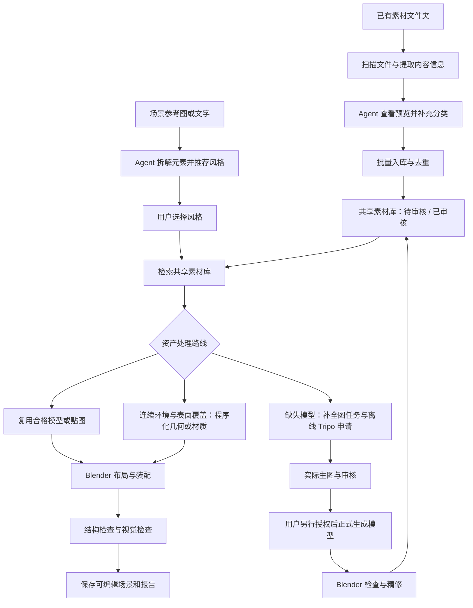

# Blender Scene Builder

**把参考图、现有三维素材和 Blender 场景制作串成一条可检查、可积累的工作流。**

这是一个面向 Codex / Agent Skills 的技能，当前版本为 **v0.8.1**。它指导 Agent 分析场景、推荐风格、整理模型和贴图、优先复用已有资产，再通过 Blender 完成装配与检查。仓库中的 Python 工具负责文件处理、资产索引、状态管理、离线申请和 Blender 脚本编译。

你可以从两个入口使用它：

- **已经有素材：** 给它一个文件夹，扫描文件、查看内容、分类、去重并批量入库，供后续项目使用。
- **想从参考图制作场景：** 给它图片或文字描述，先拆解场景和选择风格，再决定哪些资产复用、哪些补充、哪些用 Blender 程序化制作。

> 当前项目采用 Library First：先查素材库，缺什么补什么。默认 Tripo 流程只生成离线申请材料，不会提交付费任务。完整的视觉识别、生图和场景执行依赖 Agent 的实际工具能力。

## 目录

- [能实现什么效果](#能实现什么效果)
- [整体工作流](#整体工作流)
- [安装和运行条件](#安装和运行条件)
- [工作流一：整理现有素材文件夹](#工作流一整理现有素材文件夹)
- [工作流二：从参考图规划和搭建场景](#工作流二从参考图规划和搭建场景)
- [植被、岩石与苔藓怎么处理](#植被岩石与苔藓怎么处理)
- [素材库放在哪里，怎样换位置](#素材库放在哪里怎样换位置)
- [审核、复用与跨项目积累](#审核复用与跨项目积累)
- [离线演示与输出文件](#离线演示与输出文件)
- [当前实现范围与限制](#当前实现范围与限制)
- [项目结构、测试与许可证](#项目结构测试与许可证)

## 能实现什么效果

| 输入或需求 | 工作方式 | 可以得到的结果 |
|---|---|---|
| 一个已有模型、贴图文件夹 | 递归扫描、结构信息提取、Agent 查看预览、分类和去重 | 带来源、分类、风格和审核状态的共享素材库，以及导入报告 |
| 一张海岸、村落、花园等场景图 | Agent 识别主要元素，区分独立模型、重复物体、连续环境和表面覆盖 | 结构化元素清单、风格方案和资产制作计划 |
| 新场景需要已有石块、草丛或树木 | 检索风格、资产家族、能力及授权都匹配的已审核素材 | 将匹配资产复制到项目，跳过相应的重复生成申请 |
| 素材库为空或缺少某种资产 | 为必要的基础变体准备单体图任务和离线 Tripo 申请 | 可继续补图、审核和正式生成的申请材料；不会凭空得到 GLB |
| 地形上需要重复放置岩石或草丛 | 基础模型 + 指定区域、数量、随机种子和尺度范围 | 小规模 linked Mesh 实例化脚本；实际执行后才有 Blender 中的分布结果 |
| 岩石或地面需要苔藓覆盖 | 优先纹理/Shader，近景立体团块另用模型 | 材质补充计划或可在 Blender 中实现的覆盖方案 |
| 需要可继续编辑的场景 | Agent 配合 Blender 执行、检查与保存 | 完成实际建模和视觉检查后，可交付 `.blend`、截图与报告 |

例如，制作一个“有草坡、灌木、岸边岩石和小屋的风格化海湾”时，工作流可以把任务拆成：坡面和水面由 Blender 制作，草丛/灌木/岩石优先找已有模型，小屋缺少则准备单体参考图与申请。基础模型完成后，再在适当区域实例化布置。

**这里描述的是工具配合后的制作效果。** 本仓库尚未提供真实 Blender 成片或渲染效果图作为验收样例；离线测试通过只能证明相应的数据、文件和状态流程可运行。

## 整体工作流



整理素材和搭建场景可以独立进行。先整理好素材库，再制作多个场景，是本技能主要支持的使用方式。

## 安装和运行条件

在目标项目目录执行：

```bash
git clone https://github.com/lihuazou-2006/building-for-blender.git .agents/skills/blender-scene-builder
cd .agents/skills/blender-scene-builder
python -m pip install -r requirements.txt
```

仓库名是 `building-for-blender`，安装文件夹使用技能名 `blender-scene-builder`。也可以下载 ZIP，将仓库内容放入项目的 `.agents/skills/blender-scene-builder/`，确保其中直接包含 `SKILL.md`。

| 能力 | 运行条件 |
|---|---|
| 索引、规划、离线申请等 CLI | Python 3.10+ |
| 图片检查和图片联系表 | Pillow，已列入 `requirements.txt` |
| 判断图片/模型的具体内容和视觉风格 | 能查看图片的 Agent；复杂模型通常需要实际 Blender 预览 |
| 生成真实单体补全图 | Agent 可用的图像生成工具 |
| 执行建模、材质、导入和散布 | Blender；由 Agent 操作时需可用的 Blender MCP 或等效执行工具 |
| 正式 Tripo 模型生成 | 另行确认服务能力、费用和授权；默认离线流程不需要账号或 API Key |

下面的 CLI 示例均在 **Skill 根目录**执行。只整理本地素材时，不要求先运行 Blender 或连接 Tripo。

## 工作流一：整理现有素材文件夹

### 1. 告诉 Agent 源文件夹与目标

例如：

> 用这个 Skill，把 `D:\我的素材` 扫描、识别分类并批量入库。素材库存到 `D:\三维素材库`，保留原文件，告诉我哪些还需要检查。

Agent 会按[文件夹入库流程](references/FOLDER_INGEST.md)处理。你不需要先创建场景，也不需要为整个素材库指定同一种场景风格。

### 2. 扫描文件并生成查看材料

```powershell
python scripts/folder_ingest.py scan-folder --source "D:\我的素材" --library "D:\三维素材库" --report "work/asset-scan.json" --previews
```

扫描会：

- 递归清点普通文件，记录相对路径、大小和 SHA-256。
- 尝试读取 GLB/glTF 的节点、网格、材质名，以及 OBJ 的对象、组和材质名。
- 读取图片实际格式、尺寸和可解码性，生成图片联系表供 Agent 查看。
- 结合路径和结构名做初步分类，记录检查失败的条目。

扫描报告须放在源文件夹和共享库之外。脚本跳过链接、junction 和目标库目录；压缩包不会自动解压，目录中的脚本不会被执行。

### 3. Agent 补充内容识别和分类

文件名和模型内部名称是线索。准确判断“这是海岸草丛还是另一种植物”“是写实还是赛璐璐”“图片是参考照片还是颜色贴图”，仍需 Agent 查看联系表、原图或模型预览。

Agent 可以生成 `analysis.json`，补充名称、类别、`asset_key`、实际风格、图片用途和检查证据。每项分类绑定原文件的 SHA-256，避免旧分类被用到变更后的文件上。格式见[内容分类报告](references/FOLDER_INGEST.md#内容分类报告)。

无法确认的内容保持 `unknown` 或 `semantic_review=needed`，不会伪装成识别成功。

### 4. 批量入库

已有 Agent 分类报告时：

```powershell
python scripts/folder_ingest.py import-folder --source "D:\我的素材" --library "D:\三维素材库" --report "work/asset-scan.json" --analysis "work/analysis.json"
```

也可一条命令完成本地初分与入库：

```powershell
python scripts/folder_ingest.py import-folder --source "D:\我的素材" --library "D:\三维素材库" --report "work/asset-scan.json" --previews
```

第二种方式在扫描报告不存在时自动扫描；它本身不执行 Agent 的视觉识别。报告已存在但源文件发生变化时，应重新运行 `scan-folder`，再导入。

### 5. 入库后可以看到什么

- `catalog.json`：资产名称、类别、家族、风格、来源、哈希、授权与审核状态。
- 分类目录：自包含 GLB、用途已识别的贴图、参考图或待确认图片。
- `sources/`：完整源目录快照，保留 MTL、BIN、贴图等配套资源的相对位置。
- `imports/`：扫描记录、分类报告、实际新增/重复/失败及待识别项。

同一批文件重复导入不会持续新增相同资产。图片去重区分用途；非自包含模型还考虑源文件夹摘要，避免 glTF 的 BIN 或贴图变化后被当成完全相同的模型。

源文件保留，库中快照和分类副本会额外占用磁盘。请指定实际素材根目录。重复导入不会覆盖已有分类和审核结果，宜在首次导入前完成语义分类。

## 工作流二：从参考图规划和搭建场景

### 第一步：分析元素，选择风格

向 Agent 提供图片或描述，并说明场景用途、气氛和主要视角。例如：

> 根据这张海岸参考图制作一个可编辑 Blender 场景。重点保留草坡、岩石和小屋的关系，先推荐风格，再告诉我哪些资产可以复用。

Agent 列出可辨识的主要实体，把可见事实写入 `observed`，遮挡处的推断写入 `inferred`。然后推荐 3–5 种适合当前场景的视觉风格，待用户选择后写入风格文件。

### 第二步：区分四类制作任务

| 类型 | 示例 | 处理方式 |
|---|---|---|
| 独立资产 | 小屋、船、树、灌木、石块 | 检索模型库；缺少则准备独立资产任务 |
| 重复分布 | 草地、树林、乱石区 | 少量基础模型 + Blender 实例化 |
| 连续环境 | 山坡、道路、沙滩、水面 | Blender Mesh / Curve / Geometry Nodes / Shader |
| 表面覆盖 | 苔藓、湿沙、岩石表面纹理 | 优先纹理库和材质，必要时补充纹理任务 |

### 第三步：优先匹配共享素材库

`plan-growth` 检查资产家族、类别、风格、能力、授权、审核状态和文件完整性，给每项资产安排路线。`apply-reuse` 将合格素材复制到项目，保留来源 ID 和哈希。

例如库里有已审核的风格化海岸岩石，就可以将它用于匹配的岩石任务；库里只有未审核石块或另一种风格时，不会仅凭“类别都是 rock”就替代。

### 第四步：补充缺失素材

缺少独立模型时，`prepare-mock` 生成单体图片任务和离线 Tripo 申请。Agent 使用实际生图工具完成图片后，再登记和审核必需视图。

一个 `asset_id` 对应一个基础模型申请。需要三个石块变体时，应建立三个不同 ID；散布数量不会自动转成相同数量的生成任务。

默认申请队列保持 `offline_mock`、`real_tripo_calls=0`、`is_submitted=false`。正式生成是另一步，需要明确数量、预算与重试策略。获得真实 GLB 后，还须在 Blender 检查、精修并审核入库。

### 第五步：Blender 装配与检查

在确认布局后逐步添加地形、建筑、植被、材质和灯光。重复资产在指定地面和范围内布置，完成后检查主视角及辅助视角，再保存可编辑 `.blend` 和截图。

仓库包含固定海湾示例构建器和小规模散布后端。针对用户任意参考图的具体建模、布局和材质调整，仍由 Agent 配合实际 Blender 工具完成。编译 Python 源码不会自动产生场景文件。

## 植被、岩石与苔藓怎么处理

以“草坡上有灌木，岩石表面长苔藓”为例：

1. **坡面：** 先在 Blender 中创建或选择真实地面 Mesh。
2. **草丛和灌木：** 优先找已审核、风格一致的基础模型。缺少时准备少量变体的补充任务。
3. **分布：** 指定地面对象、XY 范围、数量、随机种子和尺度范围，再编译散布脚本。
4. **薄层苔藓：** 优先贴图/Shader；颜色贴图可从库里复用，法线或粗糙度图不会被当成颜色图使用。
5. **近景苔藓团：** 有明显体积时可作为独立模型，再实例化布置。

当前散布器导入基础 GLB 后，随机采样并向地面射线贴地，创建共享 Mesh 数据的对象副本。每项最多 **300 个实例**，所有任务合计最多 **800 个实例**，属于小规模验证后端。

它没有自动从照片提取精确植被覆盖遮罩，也没有完成生产级 Geometry Nodes、大规模草地优化、坡度权重、碰撞避让或真实风摆。森林、大片草地等场景需要进一步接入对应 Blender 工作流。细节见[散布说明](references/BLENDER_SCATTER.md)。

## 素材库放在哪里，怎样换位置

所有库管理命令按以下优先级确定位置：

1. `--library` 指定的路径。
2. 环境变量 `BLENDER_ASSET_LIBRARY`。
3. 默认 `<用户主目录>/Documents/Codex/SharedAssetLibrary`。

Windows 默认路径示例为 `C:\Users\<用户名>\Documents\Codex\SharedAssetLibrary`。首次初始化或导入时创建。

```powershell
python scripts/asset_library.py init --library "D:\三维素材库"
python scripts/asset_library.py list --library "D:\三维素材库"
python scripts/asset_library.py plan-growth --project "D:\项目\海湾" --library "D:\三维素材库"
```

后续审核、检索和复用须继续使用同一个库路径。`--library` 选择使用哪个库，不自动搬迁旧库。

### 共享库与项目内素材有什么区别

```text
SharedAssetLibrary/                       # 跨项目积累
  catalog.json
  models/<category>/<id>/original.glb
  textures/<category>/<id>/original.*
  images/<category>/<id>/original.*
  sources/<folder-digest>/...              # 保留配套资源的源快照
  imports/<folder-digest>.json

场景项目/
  asset_library/                          # 本项目图片、裁切和审核材料
  assets/                                 # 本项目已准备好的模型/贴图
  tasks/                                  # 图片任务
  tripo_requests/                         # 离线申请
  generated/                              # 待执行的 Blender Python
  results/                                # 实际运行后保存的结果
```

单项 `register-model` / `register-texture` 命令使用的库内文件名与批量入库略有不同，以 `catalog.json` 中的实际路径为准。

## 审核、复用与跨项目积累

**收进库、识别内容、确认质量、用于场景，是不同阶段。** 批量导入后默认 `registered_unverified`；分类完成不代表模型已经质量合格。

在 Blender 真正检查模型的几何、比例、原点、法线、UV、材质与依赖后，使用真实检查报告批准复用：

```powershell
python scripts/asset_library.py approve-model --library "D:\三维素材库" --id MODEL_ASSET_ID --report "work/real_blender_review.json" --reviewer USER --confirm-review
```

模型报告模板见 [review_report.template.json](examples/review_report.template.json)，贴图报告模板见 [material_review.template.json](examples/material_review.template.json)。模板中的检查结果必须基于实际检查填写。

批准还要求素材允许跨项目复用。导入时若已经确认授权，可添加 `--allow-reuse --license-note "授权说明"`；没有确认也可以收集，但不会自动获准复用。CLI 记录的是用户确认的检查结果，不会自己打开 Blender 验证报告真伪。

复用匹配同时检查：

- `asset_key`：是否属于同一个语义家族，如 `shore_rock`。
- `category` 和 `style_id`：类别及实际视觉风格是否匹配。
- `required_capabilities`：需要的碰撞、风摆等能力是否已核验。
- 审核、授权、文件存在性和哈希：当前素材是否仍然有效。

目前是确定性的字段匹配，不是图像语义相似度搜索。Agent 应在分类时使家族 key 与场景需求一致。

FBX、OBJ、BLEND 等先以 `source_model` 归档；转换并打包为自包含 GLB、以新 ID 登记和审核后，才能进入当前模型自动复用链。共享库积累的是实际完成的基础资产，后续新项目因此可以减少重复制作。

## 离线演示与输出文件

### 无参考图、无模型也能运行的规划示例

以下示例使用仓库自带的三项分析数据和演示风格，仅验证规划与离线申请流程。真实项目仍应由 Agent 分析用户参考图并让用户选择风格。

```powershell
python scripts/asset_library.py init --library work/demo-library
python scripts/scene_builder.py init --project work/demo-scene --preset blank
python scripts/mock_asset_pipeline.py import-analysis --project work/demo-scene --file examples/cold_start_grass_rock_moss.sample.json
python scripts/scene_builder.py select-style --project work/demo-scene --id japanese_cel
python scripts/asset_library.py plan-growth --project work/demo-scene --library work/demo-library
python scripts/asset_library.py apply-reuse --project work/demo-scene --library work/demo-library
python scripts/mock_asset_pipeline.py prepare-mock --project work/demo-scene --no-crops
python scripts/mock_asset_pipeline.py queue-status --project work/demo-scene
```

空库下会规划岩石和草丛的缺失模型申请，以及苔藓表面材质补充；`--no-crops` 允许本示例在没有参考图时运行。它不会产生真实补全图、GLB 或 `.blend`。项目初始化拒绝静默覆盖，重复演示请使用新的目录。

### 常见输出与含义

| 文件 | 意义 |
|---|---|
| `scene_elements.json` | Agent 的场景观察与推断清单 |
| `style_choice.json` / `style_guide.json` | 用户选择及风格约束 |
| `asset_library_growth_plan.json` | 每项内容走复用、补充申请、材质还是程序化环境路线 |
| `asset_manifest.json` | 项目素材路径、来源、状态和实例化信息 |
| `tasks/*_image_job.json` | 待实际生成图片的任务 |
| `tripo_requests/*_request.json` | 尚未正式提交的资产申请材料 |
| `tripo_submission_queue.json` | 离线申请队列、缺失视图及审核状态 |
| `generated/mcp_scatter.py` | 待在实际 Blender 场景中执行的散布源码 |
| `results/scatter_scene.blend` | 散布脚本实际成功执行并保存后才会出现的场景文件 |

## 当前实现范围与限制

| 功能 | 当前状态 |
|---|---|
| 递归扫描、哈希、初步分类、批量入库和去重 | 已实现并离线测试 |
| GLB/glTF/OBJ 结构信息提取、图片检查和联系表 | 已实现；图片格式取决于解码器 |
| 结合预览完成内容和风格识别 | Agent 工作流，独立 CLI 不自带视觉模型 |
| 已审核 GLB 与兼容颜色贴图的严格匹配及项目复制 | 已实现并离线测试 |
| 缺失资产图片任务和 Mock Tripo 队列 | 已实现并离线测试 |
| 单体补全图生成 | 需要 Agent 的实际生图工具 |
| Tripo 正式服务提交与生成后自动入库 | 不在默认流程；未完成端到端实机联调 |
| 海湾示例构建与 linked Mesh 散布源码 | 已实现；实际 Blender 效果仍需实机验证 |
| 任意照片自动完整重建、精确植被遮罩 | 尚未实现通用自动流程 |
| FBX/OBJ/BLEND 等自动转 GLB、整套 PBR 自动连线 | 尚未实现 |
| 生产级 Geometry Nodes、自动 LOD、碰撞、风摆、骨骼 | 需要进一步实现和实际检查 |

因此，最适合当前版本的用途是：**建立本地素材库、验证资产复用和补充路线、准备可审核的生成材料，并配合 Agent / Blender 完成有明确范围的场景制作。**

## 项目结构、测试与许可证

```text
SKILL.md                  # Agent 的入口与任务路由
scripts/
  folder_ingest.py         # 素材文件夹扫描与批量入库
  asset_library.py         # 共享库登记、审核、检索、规划与复用
  mock_asset_pipeline.py   # 场景分析导入、图像登记与离线申请
  scene_builder.py         # 项目、风格、示例构建与遗留 live CLI
  scatter_library.py       # 编译实例散布脚本
runtime/                  # 实际交给 Blender 执行的模板
references/               # 按任务读取的详细流程
examples/                 # 数据格式和审核报告模板
tests/                    # 隔离临时目录的离线测试
```

运行测试：

```bash
python -m unittest discover -s tests -v
```

当前发布版有 **41 项离线测试**，覆盖项目初始化、风格门禁、模型/贴图登记与审核、匹配和复用、文件夹扫描、结构名识别、依赖保留、重复导入、哈希变化、分类报告及 Mock 队列。测试图片由代码临时生成，不附带照片或第三方素材库。测试通过不代表真实 Blender、Tripo 服务或第三方插件已经完成实机验收。

进一步阅读：[技能入口](SKILL.md) · [文件夹入库](references/FOLDER_INGEST.md) · [场景工作流](references/SCENE_WORKFLOW.md) · [素材库成长](references/LIBRARY_GROWTH.md) · [Blender 散布](references/BLENDER_SCATTER.md)。

源码、技能说明与仓库自带示例采用 [MIT License](LICENSE)。用户导入的模型、贴图和外部插件仍遵循各自原有许可证，不因入库而改变授权。
